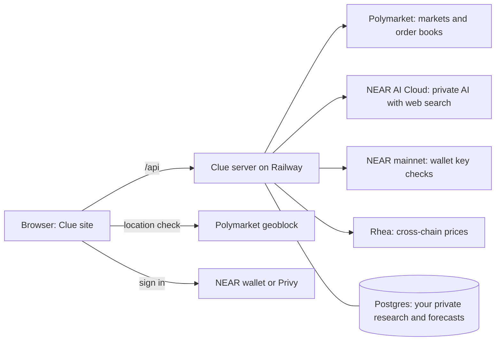

<p align="center">
  
</p>

<h1 align="center">Clue Markets</h1>

<p align="center">
  <b>A clearer view of what comes next.</b><br>
  Research any question, see where real prediction markets stand, record your own private forecast, and learn from what happens.
</p>

<p align="center">
  <a href="https://clue-markets.vercel.app">Live site</a> ·
  <a href="#try-it-in-five-minutes">Try it</a> ·
  <a href="#quick-start">Run it yourself</a> ·
  <a href="docs/TRADING_PLAN.md">Trading plan</a> ·
  <a href="docs/SECURITY_REVIEW.md">Security</a> ·
  <a href="docs/ROADMAP.md">Roadmap</a>
</p>

<p align="center">
  <a href="LICENSE"></a>
  <a href="https://near.org"></a>
  <a href="https://nearhackathon.com"></a>
</p>

<p align="center"></p>

## What is Clue?

Prediction markets put a price on questions like "Will the Fed cut rates?" A price is not an explanation. To form your own view you have to read the exact resolution rules, find evidence on both sides, remember what you thought and why, and notice when something changes. That work is scattered across a dozen tabs, and almost nobody keeps a record of their reasoning, so almost nobody learns from being right or wrong.

Clue puts it in one place. Pick a real market, read exactly how it resolves, ask an AI research assistant to find sources for and against, write down your own probability and what would change your mind, and come back to see how you did. Clue never decides an outcome and never holds your money: Polymarket's own rules settle every market, and your notes are private to you unless you choose to share one.

Clue shows live Polymarket data and previews trades against the real order book. **Placing real orders is not built yet.** See [What works today](#what-works-today).

## What you can do

| | |
| --- | --- |
| **Explore markets** | A live board of Polymarket questions with category tabs, search and sorting (trending, volume, new, ending soon). Prices are what traders are paying, shown as chances. They are not Clue's forecast. |
| **Read the exact question** | Every market page shows the venue's own resolution text, resolution source and status, a price chart (1 day to all time) and the live order book with spread and depth. |
| **Research with sources** | Ask any question, with or without a market. AI running on NEAR AI Cloud searches the web and returns an answer with its source links. Only links the search actually returned are kept. Answers are labelled AI-generated and may be wrong. |
| **Forecast privately** | Set your probability, write why, list evidence for and against, and say what would change your mind. Each save is a dated revision, and earlier ones are kept. |
| **Preview a trade** | A trade ticket walks the live order book and shows the shares you would get, the average price, the estimated Polymarket fee, and what you would win or lose. It warns about thin books, minimum size and slippage. It checks your location first. **It cannot place an order.** |
| **Add money** | On a market page, see what it would cost to bring USDC from Ethereum, Base or Optimism into the dollars Polymarket trades with. People who sign in with just an email get a wallet made for them. Prices come from Rhea's cross-chain service. A price check only: nothing is sent yet. |
| **Revisit and share** | Saved research and forecasts live under **Journal**. Export a thread, delete it, or publish a snapshot of the research alone (never your private forecast). |
| **Free research, capped** | Each account gets 2 free researches a day on NEAR AI's cheapest model, and all free research together stops at a daily dollar cap (default $0.25), so it cannot drain the account that pays for it. |
| **Funding prices** | On a market page, see what it would cost to bring USDC from Ethereum, Base or Optimism into pUSD on Polygon, the money Polymarket trades with. Prices come from Rhea's cross-chain API. Quote only: nothing is sent yet. |
| **Memory loop** | Each forecast records the market's price at that moment (read by the server, not the browser) and which outcome you meant. The **Journal** compares it with the market every time you open it: price moves, gaps, closing dates, and resolution. When a market resolves, Clue scores your forecast against the market's price at the time and asks what you learned. It will not claim you are good or bad until at least 5 forecasts have resolved. |
| **Sign in your way** | A NEAR wallet (a signed message, no transaction) or Privy (email or an Ethereum wallet). |

## What works today

This table separates what has been run from what has not. Nothing here is claimed without a check.

| Feature | Status |
| --- | --- |
| Live market board, market pages, chart, rules, order book | **Verified** against live Polymarket data |
| Trade ticket preview and location check | **Verified**: matches an independent calculation from the raw order book; 7 tests |
| AI research with sources (NEAR AI Cloud) | **Verified** by API call and in a browser; needs a `NEAR_AI_API_KEY` on the server |
| Private forecast journal, saving, sharing, deleting | **Verified** in tests and a browser; accounts cannot see each other's data (tested) |
| Add money price check (Rhea cross-chain prices) | **Verified** against Rhea's live service: 25 USDC from Ethereum or Base gave about 24.95; no money moves |
| Security review and red team | **Done**: 6 findings fixed with tests, see [docs/SECURITY_REVIEW.md](docs/SECURITY_REVIEW.md); open items are listed there |
| NEAR wallet sign-in | **Partly verified**: the signed-message and key checks are tested; a sign-in with a real wallet app on mainnet has not been recorded |
| Email sign-in (Privy), and the wallet made for email users | **Verified** on the live site |
| Placing real orders on Polymarket | **Not built.** Planned in [docs/TRADING_PLAN.md](docs/TRADING_PLAN.md); it can only be proven with a funded test wallet |
| Funding from other chains with NEAR Intents | **Not built** |
| Alerts when evidence changes, replay and scoring after resolution, public profiles | **Not built** |

## Try it in five minutes

Open **https://clue-markets.vercel.app**. Nothing needs signing in until step 5.

1. **See the markets.** The home page lists live Polymarket questions. *You should see* cards with chances and Yes/No buttons, and a "Live from Polymarket" time.
2. **Open one.** Click any card, for example *Democratic Presidential Nominee 2028*. *You should see* the candidates ranked by probability, a price chart you can hover, and tabs for **Rules** and **Order book**.
3. **Read how it resolves.** Open the **Rules** tab. *You should see* Polymarket's own wording, the resolution source and the market ID.
4. **Preview a trade.** In the **Trade** card enter an amount. *You should see* shares, average price, estimated fee and win/lose amounts from the live book. The button says "not available yet" on purpose. The card also shows whether Polymarket allows orders from your location.
5. **Sign in.** Click **Sign in** and choose the NEAR wallet or Privy.
6. **Research.** Open **Ask Clue**, type a question such as *Will the Fed cut rates in December?* and click **Research with sources**. *You should see* a report with source links that you can open. (This step needs the server to have a NEAR AI key.)
7. **Forecast.** Set your probability, write your reasoning and what would change your mind, and click **Save forecast**. *You should see* it under **Journal** with its date. Save again to add a revision.
8. **Check the prices for adding money.** On a market page, find **Add money**, pick where your money is, and click **See what I'd get**. *You should see* what you would receive, the fees and the time. Nothing is sent.

<table>
  <tr>
    <td></td>
    <td></td>
  </tr>
  <tr>
    <td align="center"><b>A market page</b>: exact question, live prices, trade preview (the location line shows the screenshot was taken from a US address, where Polymarket blocks new orders)</td>
    <td align="center"><b>On a phone</b></td>
  </tr>
</table>

## Quick start

You need Node 22 or newer (the project targets Node 24).

```sh
git clone https://github.com/majorlabs/cluemarket.git && cd cluemarket/clue-agent
npm install
npm run preview            # http://127.0.0.1:3000
```

With no keys set, the markets, charts, order books, trade preview and the Add money price check all work. Research needs `NEAR_AI_API_KEY`. Sign-in needs a wallet. Data is stored in a local SQLite file under `.clue-data/` (not encrypted; use only test data).

Run the tests from the `clue-agent` folder:

```sh
node --test tests/*.mjs     # 23 tests: 22 run, 1 skipped unless NEARAI_API_KEY is set
```

Settings (names only; never commit values):

| Variable | Purpose |
| --- | --- |
| `NEAR_AI_API_KEY`, `NEAR_AI_MODEL` | NEAR AI Cloud key for research, and an optional model override |
| `PRIVY_APP_ID`, `PRIVY_APP_SECRET` | Privy sign-in. Sign-in needs only the app ID; the secret is used only to show an email or wallet as the account name |
| `DATABASE_URL`, `BETTER_AUTH_SECRET`, `BETTER_AUTH_URL` | Postgres and auth, for a hosted deployment |
| `CLUE_HOSTED`, `CLUE_SERVICE_HOST`, `CLUE_SIGNUP_TOKEN` | Hosted-mode switches |
| `CLUE_PUBLIC_ORIGINS` | Extra https addresses allowed to sign in (default adds `https://clue-markets.vercel.app`) |
| `CLUE_RESEARCH_GLOBAL_PER_HOUR` | Overall hourly research budget for all accounts (default 60) |
| `POLYMARKET_BUILDER_*` | Reserved for the planned trading phases. Not used yet |

## How it works



The site is plain HTML, CSS and JavaScript served from Vercel. It talks to one Node server on Railway, which reads Polymarket's public data, calls NEAR AI Cloud for research, and keeps each user's research and forecasts in Postgres. The server produces and stores every research answer itself and only lets a user save or share an answer it produced. It removes any link that the web search did not return. Details and the attacks that were tried are in [docs/SECURITY_REVIEW.md](docs/SECURITY_REVIEW.md).

## NEAR in Clue

| Where | What NEAR does |
| --- | --- |
| **NEAR AI Cloud** | Runs the research model with web search. The question and, if chosen, the market's rules are sent to it. |
| **NEAR wallet sign-in** | You sign one message with your own wallet key. The server checks the signature and asks NEAR mainnet that the key is a full-access key for that account. No transaction, no funds move. |
| **Rhea** | Gives prices for moving USDC from another chain into pUSD on Polygon (`/api/v2/swap/quote`). Quotes only; the key stays on the server. |
| **NEAR Intents** | **Planned, not built**: funding a Polymarket account from other chains. See [docs/TRADING_PLAN.md](docs/TRADING_PLAN.md). Clue does not claim NEAR Intents supplies Polymarket's liquidity: orders match on Polymarket's own order book. |

## Built with

Node.js, plain JavaScript front end, `better-auth` with SQLite or Postgres (`better-sqlite3`, `pg`), `@near-js/crypto`, `@hot-labs/near-connect` (NEAR wallet), `@privy-io/react-auth` (loaded only when Privy sign-in is chosen), `@rhea-finance/rnear-sdk`, `esbuild`, React 19 (Privy window only), Geist and Geist Mono fonts (SIL Open Font License). Market data: Polymarket Gamma and CLOB public APIs. Photo on the cover image: NASA, Apollo 17 (public domain).

Much of the code was written with AI coding assistants (Claude Code and Codex) and reviewed and tested by the team, as the NEAR Hackathon rules allow. The product work began on 5 November 2026, inside the hackathon window.

## Security

Private research is isolated per account, and a test proves it by trying to read, publish and delete another account's data. Saving and sharing research is limited to answers the server itself produced; links that did not come from the web search are removed; the site cannot be framed by other sites; every state-changing request needs an approved origin; and research has per-account and overall hourly budgets. The review used a model with its refusals removed (on NEAR AI Cloud) to attack Clue's own research pipeline, and each confirmed issue was fixed with a test. Read [docs/SECURITY_REVIEW.md](docs/SECURITY_REVIEW.md), including what is still open.

## Documentation

| | |
| --- | --- |
| [Product and build brief](docs/PRODUCT_AND_BUILD_BRIEF.md) | The vision, journeys, trust boundaries and build gates |
| [Roadmap](docs/ROADMAP.md) | The build order and acceptance criteria |
| [Trading plan](docs/TRADING_PLAN.md) | How trading on Polymarket's order book will work, in phases, and what each phase needs |
| [Research agents](docs/RESEARCH_AGENTS.md) | How research is meant to work and its boundaries |
| [Security review](docs/SECURITY_REVIEW.md) | Findings, fixes and what remains open |
| [Integration findings](docs/INITIAL_INTEGRATION_FINDINGS.md) | Early notes on Polymarket, NEAR AI and NEAR Intents |
| [Contributor rules](AGENTS.md) | The rules the project follows |

## Limitations

- Clue is not a trading venue, an oracle or financial advice. A forecast here is not a trade.
- Polymarket blocks or limits orders from many countries, including the US and UK. Clue checks and will never help get around it.
- AI research can be wrong, out of date or manipulated by hostile text. Check the sources.
- Real-order trading and NEAR Intents funding are not built (see above).
- Data stored by the local preview is not encrypted. The hosted service uses Postgres.

## License

[MIT](LICENSE)
