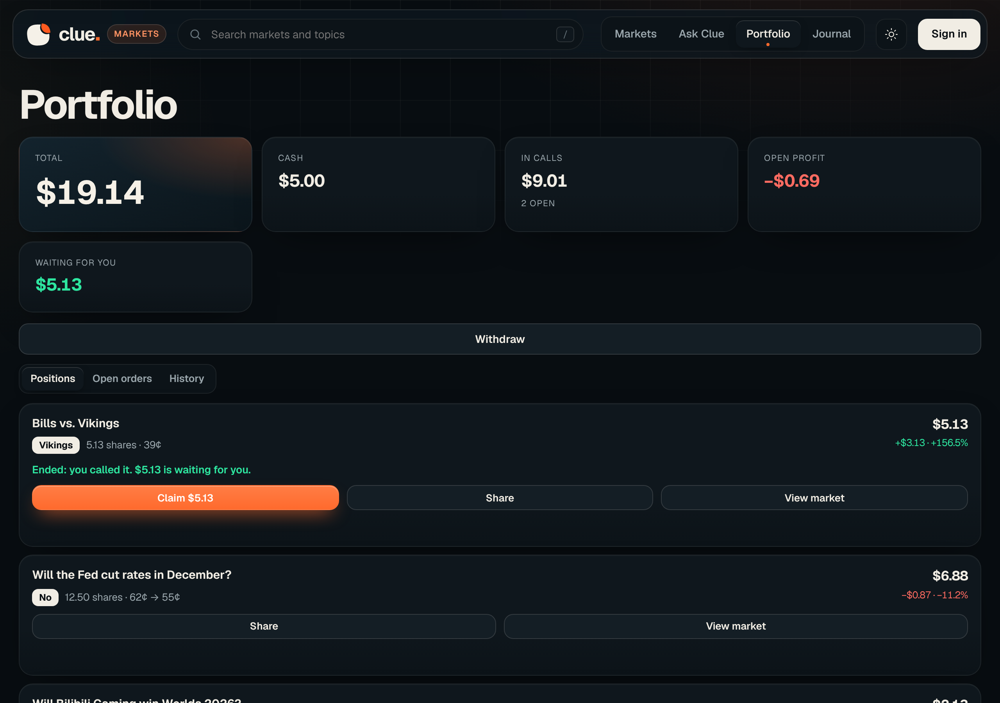
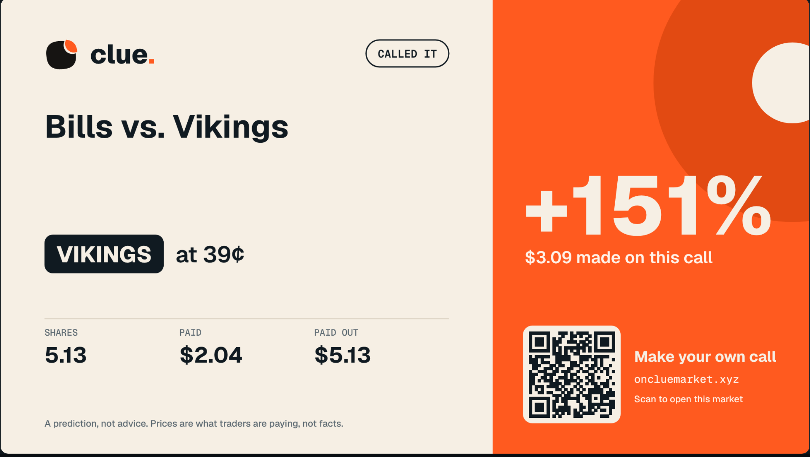
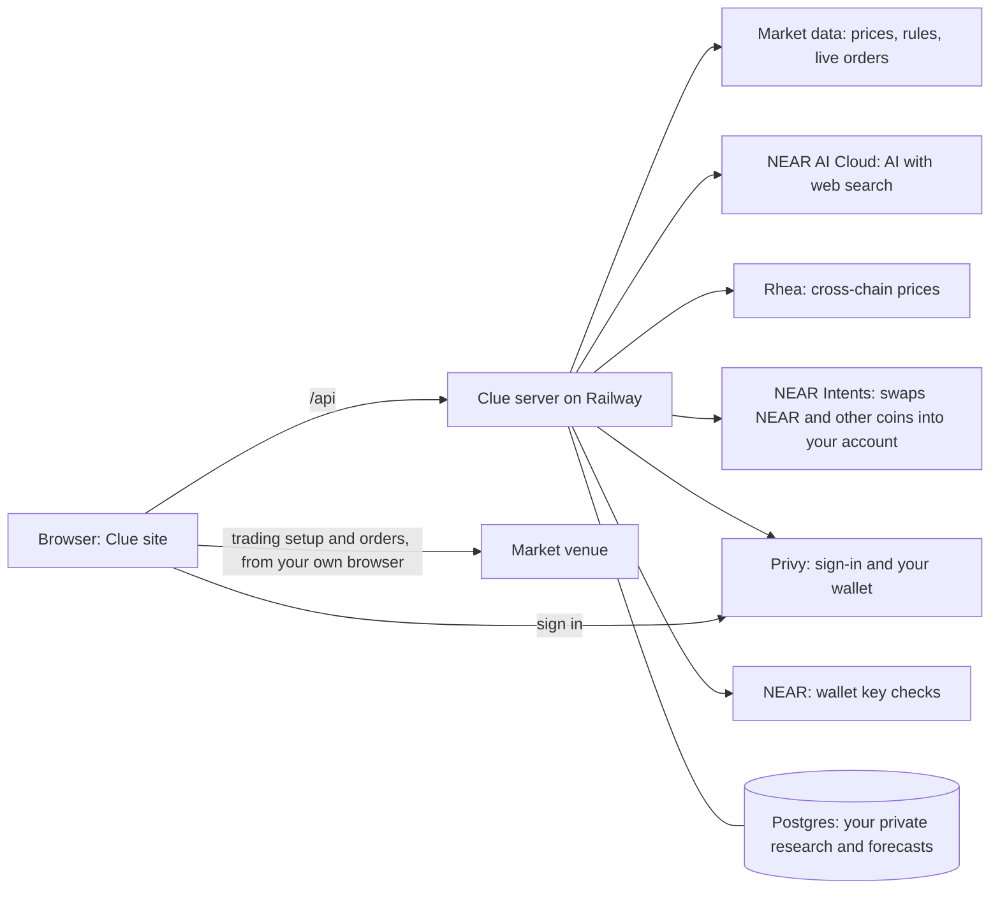

<p align="center">
  
</p>

<h1 align="center">Clue Markets</h1>

<p align="center">
  <b>A clearer view of what comes next.</b><br>
  Research any question, see where real prediction markets stand, record your own private forecast, trade it, and learn from what happens.
</p>

<p align="center">
  <a href="https://www.oncluemarket.xyz">Live site</a> ·
  <a href="#try-it-in-five-minutes">Try it</a> ·
  <a href="#quick-start">Run it yourself</a> ·
  <a href="docs/TRADING_PLAN.md">Trading plan</a> ·
  <a href="docs/SECURITY_REVIEW.md">Security</a>
</p>

<p align="center">
  <a href="LICENSE"></a>
  <a href="https://near.org"></a>
</p>

<p align="center"></p>

## What is Clue?

Prediction markets put a price on questions like "Will the Fed cut rates?" A price is not an explanation. To form your own view you have to read the exact resolution rules, find evidence on both sides, remember what you thought and why, and notice when something changes. That work is scattered across a dozen tabs, and almost nobody keeps a record of their reasoning, so almost nobody learns from being right or wrong.

Clue puts it in one place. Pick a real market, read exactly how it resolves, ask an AI research assistant to find sources for and against, write down your own probability and what would change your mind, trade it when you are sure, and come back to see how you did. Clue never decides an outcome: each market's own rules settle it. Your notes are private to you unless you choose to share one.

## What you can do

| | |
| --- | --- |
| **Explore markets** | A live board of real prediction-market questions with category tabs, search and sorting (trending, volume, new, ending soon). Prices are what traders are paying, shown as chances. |
| **Read the exact question** | Every market page shows the market's own rules, who decides it, a price chart (1 day to all time) and the live orders with spread and depth. |
| **Research with sources** | Ask any question, with or without a market. AI on NEAR AI Cloud searches the web for the latest news and numbers and returns a short answer you can take in at a glance: the short answer, the evidence for and against, what to watch, and how sure it is, with every claim linked to its source. Only links the search actually returned are kept. Everyone gets 2 free researches a day. |
| **Forecast privately** | Set your probability, write why, list evidence for and against, and say what would change your mind. Each save is a dated update, and earlier ones are kept. |
| **Journal** | Every forecast records the market's price at that moment. The Journal compares it with the market whenever you open it: price moves, gaps, closing dates and the result. When a market resolves, your forecast is scored against the market's price at the time and you can write what you learned. |
| **Share** | Publish your research (never your private forecast) as a public page, and remove it any time. |
| **Add money** | Put money in your trading account from **NEAR or another chain**. Pick a coin you hold (wNEAR, USDC or USDT on NEAR, USDC, ETH or SOL on other chains), see the price, and get a one-time deposit address. **NEAR Intents** swaps it and delivers USDC on Polygon to your own Polymarket deposit address, with live status and a refund address if it cannot finish. Every deposit stays on screen until it lands, even after a refresh: how long it has been, and when and where it goes back if it cannot finish. A deposit sent earlier can be added by pasting its address. You can also send USDC straight from Solana or Polygon. |
| **A wallet made for you** | Sign in with just an email or Google and Clue makes you a wallet. It belongs to you and Clue never holds its keys. The profile icon in the corner shows it, with Copy and Disconnect. |
| **Trade** | Buy Yes or No on the same page. The trade card walks the live orders and shows the shares you get, the price, the fee, and what you win or lose. A review box shows the order before anything is sent, then live steps follow it until it fills. Orders match on Polymarket's order book and are signed by your own wallet. |
| **Portfolio** | Your total (cash plus what you hold), every position with shares, entry and current price, value and profit or loss, and your history. **Claim** your winnings on ended markets you called, see and **Cancel** open orders, and **Withdraw** your cash as USDC to your own wallet on Base, Ethereum, Arbitrum, Optimism or Polygon. |
| **Share a call** | Turn a call into a 16:9 card (live, won or lost) with a code that opens the same market, so people who see it can trade alongside you, plus a post to go with it. On a phone the share sheet sends it to any app, and **Post on X** opens X with the text and link ready. |
| **Sign in your way** | Email, Google, an Ethereum wallet, or a NEAR wallet (a signed message, no transaction). |
| **Use it from your AI assistant** | Connect Claude, Codex, Cursor or any MCP assistant from the Agents page. It can search markets, run research, save forecasts to your Journal and read your Portfolio. |
| **Let your assistant trade** | Connect your own OutLayer agent wallet on NEAR, set your own limits per order and per day, and your assistant can buy and sell through the Clue plugin. Orders go from your own computer, and Clue checks each one against your limits before your wallet signs it. |

<table>
  <tr>
    <td></td>
    <td></td>
  </tr>
  <tr>
    <td align="center"><b>A market page</b>: the exact question, live prices and the trade card</td>
    <td align="center"><b>The Portfolio</b>: cash, positions, share and withdraw</td>
  </tr>
  <tr>
    <td></td>
    <td></td>
  </tr>
  <tr>
    <td align="center"><b>The Journal</b>: your forecast next to the market, and what changed</td>
    <td align="center"><b>A share card</b>: a live call, ready to post on X</td>
  </tr>
</table>

## Try it in five minutes

Open **https://www.oncluemarket.xyz**. Nothing needs signing in until step 5.

1. **See the markets.** *You should see* cards with chances and Yes/No buttons, and a "Live prices" time.
2. **Open one.** Click any card, for example *Democratic Presidential Nominee 2028*. *You should see* the candidates ranked by probability, a price chart you can hover, and tabs for **Rules** and **Live orders**.
3. **Read how it resolves.** Open the **Rules** tab. *You should see* the market's own wording and who decides it.
4. **Size a trade.** In the **Trade** card pick Yes or No and enter an amount. *You should see* shares, price, fee and win/lose amounts.
5. **Sign in.** Tap **Sign in** and choose email, Google, a wallet, or a NEAR wallet. With email or Google you get a wallet of your own. *You should see* a round profile icon in the corner; tap it for your wallet address, Copy, Journal and Disconnect.
6. **Research.** Open the research box on a market, or **Ask Clue**, and tap **Research with sources**. *You should see* a clock while it works, then a short answer with the evidence for and against, what to watch and how sure it is, with links you can open, and "N of 2 free researches left today".
7. **Forecast.** Set your probability, write why and what would change your mind, and tap **Save forecast**. *You should see* it in the **Journal** next to the market's price.
8. **Add money.** In the Trade card open **Add money**, choose **NEAR & other chains**, pick a coin and an amount, and tap **See what I'd get**. *You should see* what you would receive and how long it takes. **Get my deposit address** then gives you the address to send to, and the deposit stays at the top of Add money until it lands.
9. **Trade.** With cash in your account, tap **Review my order**, check the box, and place it. *You should see* live steps and then the result.
10. **Open your Portfolio.** *You should see* your cash, your positions and your history, with **Claim**, **Cancel** and **Withdraw** where they apply.

<p align="center"></p>

On a phone, Markets, Ask Clue, Portfolio and Journal sit in a tab bar at the bottom of the screen, so every page is one tap away. Clue opens in its light look, and there's a dark one too, and the sun or moon button in the header switches between them.

## Quick start

You need Node 22 or newer (the project targets Node 24).

```sh
git clone https://github.com/majorlabs/cluemarket.git && cd cluemarket/clue-agent
npm install
npm run preview            # http://127.0.0.1:3000
```

With no keys set, the markets, charts, live orders and the trade card work. Research needs `NEAR_AI_API_KEY`, the Add money price check needs `RHEA_API_KEY`, and email sign-in needs `PRIVY_APP_ID`. Data is stored in a local SQLite file under `.clue-data/` (not encrypted; use only test data).

Run the tests from the `clue-agent` folder:

```sh
node --test tests/*.mjs     # one test is skipped unless NEARAI_API_KEY is set
```

Settings (names only; never commit values):

| Variable | Purpose |
| --- | --- |
| `NEAR_AI_API_KEY`, `NEAR_AI_MODEL` | NEAR AI Cloud key for research, and an optional model override |
| `CLUE_FREE_RESEARCH_PER_DAY`, `CLUE_AI_DAILY_USD` | Free researches per person per day (default 2) and the daily spending cap for all free research (default $0.25) |
| `PRIVY_APP_ID`, `PRIVY_APP_SECRET` | Email and wallet sign-in, and the wallet made for email users. The secret is used by the server to look up a user's wallet |
| `RHEA_API_KEY` | Prices for the Add money check |
| `ONECLICK_JWT` | Optional partner key for NEAR Intents' 1Click service (lowers its fee). Without it, funding still works |
| `CLUE_FUND_MAX_USD` | The most that can be sent in one funding, in dollars. Default 50,000, which is where Polymarket's own guide advises another bridge |
| `POLYMARKET_BUILDER_API_KEY`, `_SECRET`, `_PASSPHRASE`, `_CODE` | Our builder account for trading. Used only on the server to sign trading setup requests; never sent to the browser |
| `DATABASE_URL`, `BETTER_AUTH_SECRET`, `BETTER_AUTH_URL` | Postgres and auth, for a hosted deployment |
| `CLUE_HOSTED`, `CLUE_SERVICE_HOST`, `CLUE_SIGNUP_TOKEN` | Hosted-mode switches |
| `CLUE_ORDERS_LIVE`, `CLUE_ORDERS_LIVE_ADDRESSES` | `CLUE_ORDERS_LIVE=1` lets orders be sent for everyone. `CLUE_ORDERS_LIVE_ADDRESSES` is a comma-separated list of wallet addresses that can send real orders while everyone else sees the review step only |
| `CLUE_PUBLIC_ORIGINS` | https addresses allowed to sign in (list them all, comma-separated) |

## Use Clue from your AI assistant

Clue is also an MCP server at `https://www.oncluemarket.xyz/api/mcp`. Sign in, open **Agents** and make a key. Then, for Claude Code:

```bash
claude mcp add --transport http clue https://www.oncluemarket.xyz/api/mcp --header "Authorization: Bearer YOUR_KEY"
```

Tools: `search_markets`, `get_market`, `research`, `research_status`, `research_allowance`, `save_forecast`, `get_journal`, `get_portfolio`, `share_card`, `my_record`, `what_changed`. Each one runs as you, through the same routes and limits as the site. A key is read-only unless you tick **Can trade** when you make it. No key can move money out or make more keys, and you can remove one at any time.

### The Clue plugin for Claude Code

The plugin adds research, the Journal and trading to Claude Code in one install:

```bash
export CLUE_KEY=clue_ak_...
claude plugin marketplace add majorlabs/cluemarket
claude plugin install clue@clue
```

It brings the tools above, the commands `/clue:research`, `/clue:portfolio`, `/clue:trade`, `/clue:card`, `/clue:record` and `/clue:brief`, a skill that teaches the assistant to research before a call and confirm every trade, and `clue-trader`, a small MCP server that runs on your computer and places orders.

### Assistant trading with an OutLayer agent wallet

1. At [app.outlayer.ai](https://app.outlayer.ai), create an agent wallet (Custody, Wallets). Its keys are held in OutLayer's secure hardware on NEAR. In its policy, allow `evm_sign` and save.
2. In Clue, open **Agents**, then **Assistant trading**, paste the wallet key and set your limits per order and per day. Switch it on, and make an assistant key with **Can trade** ticked.
3. Ask your assistant for `trading_status`, fund the trading account it shows with pUSD (or use **Add money**), and run `setup_trading` once.

Clue keeps the wallet key sealed on its server. For each order, Clue checks your limits and the live market price (a buy far above it, or a sell far below it, is refused, and so is any order when the price cannot be read), then has OutLayer sign. Every request is logged and shown under Assistant trading. It signs only Polymarket sign-in, orders on Polymarket's exchanges, and permissions for Polymarket's own contracts, and refuses everything else, including transfers and withdrawals. The signed order is sent to Polymarket from your own computer. Switch assistant trading off in Clue, or freeze the wallet on OutLayer, at any time.

## How it works



The site is plain HTML, CSS and JavaScript served from Vercel. It talks to one Node server on Railway, which reads public market data, calls NEAR AI Cloud for research, and keeps each user's research and forecasts in Postgres. The server produces and stores every research answer itself and only lets a user save or share an answer it produced. It removes any link that the web search did not return, and it reads a market's question and rules from the market itself, never from the browser.

Trading setup and orders go from the user's own browser straight to the venue, so the venue sees the user's real location. Our server's only part is signing our builder paperwork, for the user's own wallet and a short fixed list of requests. Details and the attacks that were tried are in [docs/SECURITY_REVIEW.md](docs/SECURITY_REVIEW.md).

## NEAR in Clue

| Where | What NEAR does |
| --- | --- |
| **NEAR AI Cloud** | Runs the research model with web search, on its cheapest model, with a hard daily spending cap. |
| **NEAR wallet sign-in** | You sign one message with your own wallet key. The server checks the signature and asks NEAR that the key is a full-access key for that account. No transaction, no funds move. |
| **Rhea** | Gives prices for moving USDC from another chain into Clue. Prices only; the key stays on the server. |
| **NEAR Intents** | Carries money from NEAR or any other chain into your trading account: Clue asks its 1Click service for a price and a one-time deposit address, and NEAR Intents swaps the coin and delivers USDC on Polygon to your own Polymarket deposit address. Clue never holds the money. A refund address is required. It does not supply the market's liquidity: orders match on the venue's own order book. |

## Built with

Node.js, plain JavaScript front end, `better-auth` with SQLite or Postgres (`better-sqlite3`, `pg`), `@near-js/crypto`, `@hot-labs/near-connect` (NEAR wallet), `@privy-io/react-auth` (loaded only when email sign-in is chosen), `@polymarket/client` and `viem` (loaded only when someone sets up trading), `esbuild`, React 19 (the Privy window only), Geist and Geist Mono fonts (SIL Open Font License). Coin and chain logos from `@web3icons/core` (MIT). Market data: public market APIs. Photo on the cover image: NASA, Apollo 17 (public domain).

## Security

Private research is isolated per account, and a test proves it by trying to read, publish and delete another account's data. Saving and sharing research is limited to answers the server itself produced; links that did not come from the web search are removed; market text comes from the market, not the browser; the site cannot be framed by other sites; every state-changing request needs an approved origin; research has per-person and overall limits and a daily spending cap; and emails are never shown or sent back to the browser. The review used a model with its refusals removed (on NEAR AI Cloud) to attack Clue's own research pipeline, and each confirmed issue was fixed with a test. Read [docs/SECURITY_REVIEW.md](docs/SECURITY_REVIEW.md), including what is still open.

## Repository layout

```
.
├── .claude-plugin/          # plugin marketplace for Claude Code
├── plugin/clue/            # the Clue plugin: MCP servers, skill, commands, local order sender
├── clue-agent/            the app: server, website and tests
│   ├── server.mjs         HTTP server and all /api routes
│   ├── public/            the website (HTML, JavaScript, CSS, fonts)
│   ├── tests/             automated tests
│   └── *.mjs              server modules (sign-in, journal, research limits, ...)
├── docs/
│   ├── SECURITY_REVIEW.md what was attacked, what was fixed, what is open
│   ├── TRADING_PLAN.md    how trading works and what is built
│   └── images/            screenshots used in this README
├── CONTRIBUTING.md
├── SECURITY.md
└── LICENSE
```

The app's own README, with a file-by-file table, is in [clue-agent/README.md](clue-agent/README.md).

## Contributing and security

Read [CONTRIBUTING.md](CONTRIBUTING.md) before opening a pull request. To report a vulnerability, follow [SECURITY.md](SECURITY.md); please do not open a public issue for one.

## License

[MIT](LICENSE)
