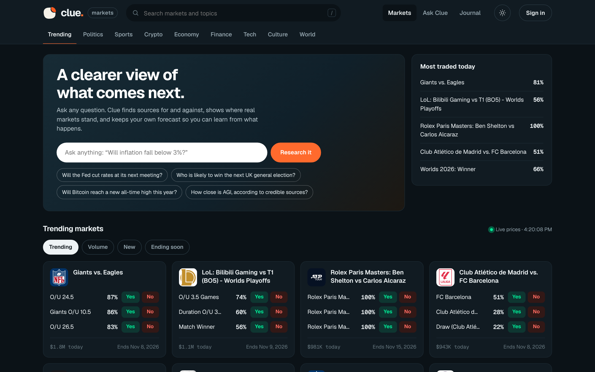
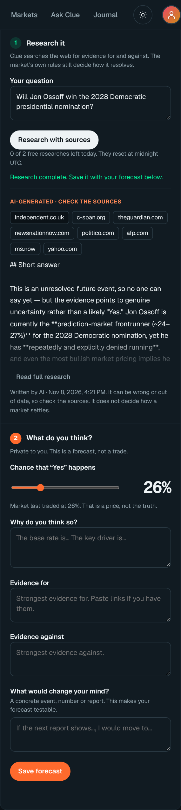
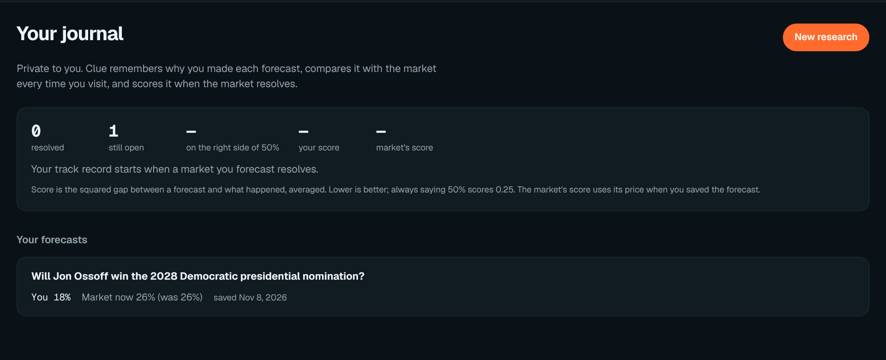
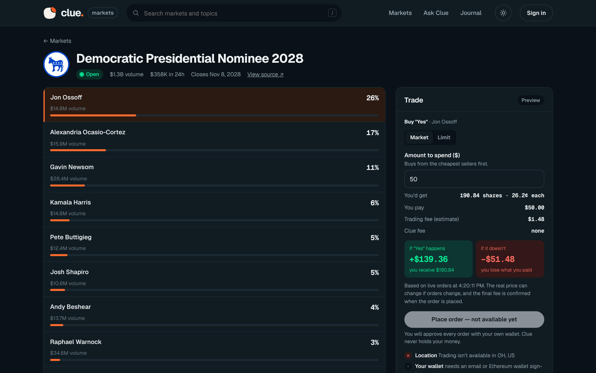
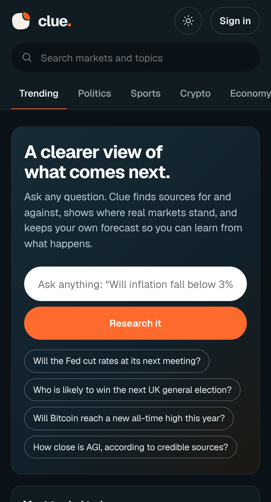
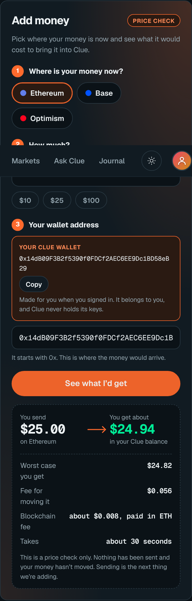
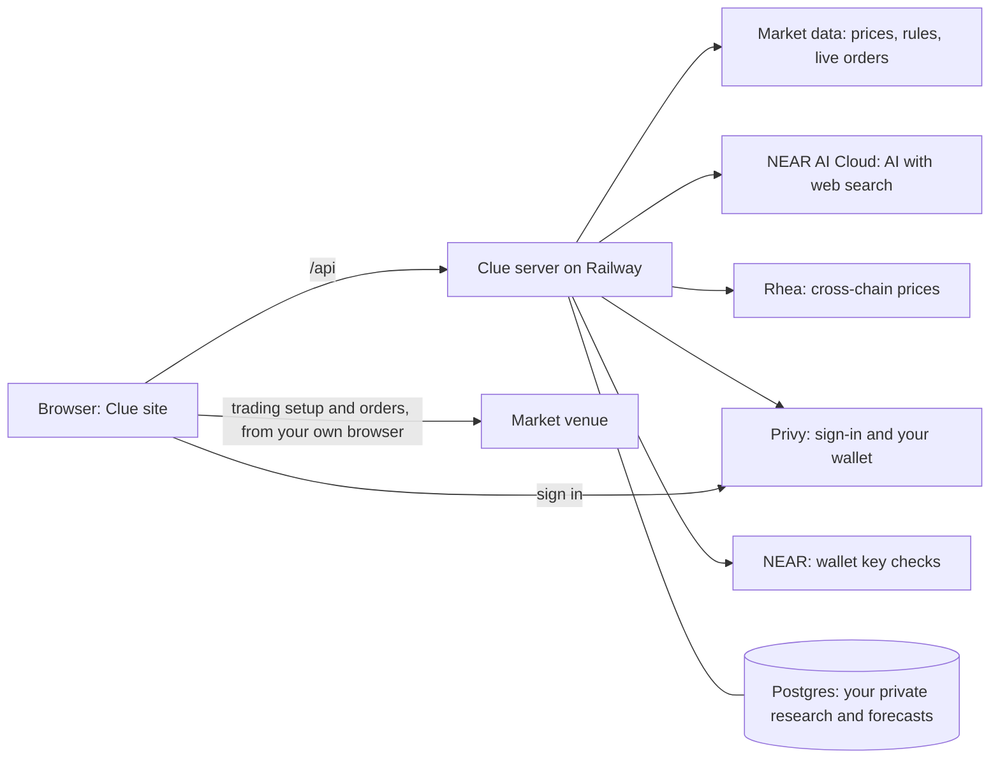

<p align="center">
  
</p>

<h1 align="center">Clue Markets</h1>

<p align="center">
  <b>A clearer view of what comes next.</b><br>
  Research any question, see where real prediction markets stand, record your own private forecast, and learn from what happens.
</p>

<p align="center">
  <a href="https://www.oncluemarket.xyz">Live site</a> ·
  <a href="#try-it-in-five-minutes">Try it</a> ·
  <a href="#quick-start">Run it yourself</a> ·
  <a href="docs/TRADING_PLAN.md">Trading plan</a> ·
  <a href="docs/SECURITY_REVIEW.md">Security</a> ·
  <a href="docs/ROADMAP.md">Roadmap</a>
</p>

<p align="center">
  <a href="LICENSE"></a>
  <a href="https://near.org"></a>
  <a href="https://nearhackathon.com"></a>
</p>

<p align="center"></p>

## What is Clue?

Prediction markets put a price on questions like "Will the Fed cut rates?" A price is not an explanation. To form your own view you have to read the exact resolution rules, find evidence on both sides, remember what you thought and why, and notice when something changes. That work is scattered across a dozen tabs, and almost nobody keeps a record of their reasoning, so almost nobody learns from being right or wrong.

Clue puts it in one place. Pick a real market, read exactly how it resolves, ask an AI research assistant to find sources for and against, write down your own probability and what would change your mind, and come back to see how you did. Clue never decides an outcome: each market's own rules settle it. Your notes are private to you unless you choose to share one.

Clue shows live market data and previews trades against the real order book. **Placing orders is not built yet.** See [What works today](#what-works-today).

## What you can do

| | |
| --- | --- |
| **Explore markets** | A live board of real prediction-market questions with category tabs, search and sorting (trending, volume, new, ending soon). Prices are what traders are paying, shown as chances. They are not Clue's forecast. |
| **Read the exact question** | Every market page shows the market's own rules, who decides it, a price chart (1 day to all time) and the live orders with spread and depth. |
| **Research with sources** | Ask any question, with or without a market. AI on NEAR AI Cloud searches the web and returns an answer with source links. Only links the search actually returned are kept. Answers are labelled as AI-written and may be wrong. Everyone gets 2 free researches a day. |
| **Forecast privately** | Set your probability, write why, list evidence for and against, and say what would change your mind. Each save is a dated update, and earlier ones are kept. |
| **Journal** | Every forecast records the market's price at that moment. The Journal compares it with the market whenever you open it: price moves, gaps, closing dates and the result. When a market resolves, your forecast is scored against the market's price at the time and you can write what you learned. It makes no claim about your skill until at least 5 forecasts have resolved. |
| **Share** | Publish your research (never your private forecast) as a public page, and remove it any time. |
| **Add money** | See what it would cost to bring USDC from Ethereum, Base or Optimism into Clue, with prices from Rhea's cross-chain service. A price check only: nothing is sent yet. |
| **A wallet made for you** | Sign in with just an email and Clue makes you a wallet. It belongs to you and Clue never holds its keys. The profile icon in the corner shows it, with Copy and Disconnect. |
| **Trade preview** | A trade card walks the live orders and shows the shares you would get, the price, the estimated fee, and what you would win or lose, with warnings for thin markets and small orders. It checks your location first. **Set up trading** creates your trading account in your own browser. |
| **Sign in your way** | A NEAR wallet (a signed message, no transaction) or an email or Ethereum wallet. |

<table>
  <tr>
    <td></td>
    <td></td>
  </tr>
  <tr>
    <td align="center"><b>Research with sources</b></td>
    <td align="center"><b>The Journal</b>: your forecast next to the market, and what changed</td>
  </tr>
</table>

## What works today

This table separates what has been run from what has not. Nothing here is claimed without a check.

| Feature | Status |
| --- | --- |
| Market board, market pages, chart, rules, live orders | **Verified** on the live site |
| Trade preview and location check | **Verified**: matches an independent calculation from the raw order book |
| AI research with sources | **Verified** on the live site, including the free limit and a daily spending cap |
| Forecasts, Journal comparison with the market, sharing, deleting | **Verified** on the live site; accounts cannot see each other's data (tested) |
| Scoring a forecast when its market resolves | **Tested**; not yet seen on the live site because it needs a market to resolve |
| Add money price check | **Verified** against Rhea's live service: about $24.95 back for $25 from Ethereum or Base. Nothing is sent |
| Email sign-in and the wallet made for you | **Verified** on the live site |
| NEAR wallet sign-in | **Partly verified**: the signed-message and key checks are tested; a sign-in with a real wallet app on mainnet has not been recorded |
| Trading setup (trading account and permission) | **Built**; the first run from a supported location is not yet recorded. Trading is blocked from the address the project was tested from |
| Placing orders | **Not built.** Planned in [docs/TRADING_PLAN.md](docs/TRADING_PLAN.md); needs a funded test wallet |
| Sending money from other chains | **Not built** (price check only) |
| Alerts when evidence changes, public profiles | **Not built** |

## Try it in five minutes

Open **https://www.oncluemarket.xyz**. Nothing needs signing in until step 5.

1. **See the markets.** *You should see* cards with chances and Yes/No buttons, and a "Live prices" time.
2. **Open one.** Click any card, for example *Democratic Presidential Nominee 2028*. *You should see* the candidates ranked by probability, a price chart you can hover, and tabs for **Rules** and **Live orders**.
3. **Read how it resolves.** Open the **Rules** tab. *You should see* the market's own wording and who decides it.
4. **Preview a trade.** In the **Trade** card enter an amount. *You should see* shares, price, estimated fee and win/lose amounts. The button says "not available yet" on purpose.
5. **Sign in.** Tap **Sign in** and choose a NEAR wallet or email. With email, you get a code and then a wallet of your own. *You should see* a round profile icon in the corner; tap it for your wallet address, Copy, Journal and Disconnect.
6. **Research.** Open the research box on a market, or **Ask Clue**, and tap **Research with sources**. *You should see* a report with links you can open, and "N of 2 free researches left today".
7. **Forecast.** Set your probability, write why and what would change your mind, and tap **Save forecast**. *You should see* it in the **Journal** next to the market's price.
8. **Check the price of adding money.** On a market page find **Add money**, pick where your money is, and tap **See what I'd get**. *You should see* what you would receive, the fees and the time. Nothing is sent.

<table>
  <tr>
    <td></td>
    <td></td>
    <td></td>
  </tr>
  <tr>
    <td align="center"><b>A market page</b>: the exact question, live prices and the trade card (the location line shows where the screenshot was taken, a US address where trading is not available)</td>
    <td align="center"><b>On a phone</b></td>
    <td align="center"><b>Add money</b>: a price, nothing sent</td>
  </tr>
</table>

## Quick start

You need Node 22 or newer (the project targets Node 24).

```sh
git clone https://github.com/majorlabs/cluemarket.git && cd cluemarket/clue-agent
npm install
npm run preview            # http://127.0.0.1:3000
```

With no keys set, the markets, charts, live orders and trade preview work. Research needs `NEAR_AI_API_KEY`, the Add money price check needs `RHEA_API_KEY`, and email sign-in needs `PRIVY_APP_ID`. Data is stored in a local SQLite file under `.clue-data/` (not encrypted; use only test data).

Run the tests from the `clue-agent` folder:

```sh
node --test tests/*.mjs     # one test is skipped unless NEARAI_API_KEY is set
```

Settings (names only; never commit values):

| Variable | Purpose |
| --- | --- |
| `NEAR_AI_API_KEY`, `NEAR_AI_MODEL` | NEAR AI Cloud key for research, and an optional model override |
| `CLUE_FREE_RESEARCH_PER_DAY`, `CLUE_AI_DAILY_USD` | Free researches per person per day (default 2) and the daily spending cap for all free research (default $0.25) |
| `PRIVY_APP_ID`, `PRIVY_APP_SECRET` | Email and wallet sign-in, and the wallet made for email users. The secret is used by the server to look up a user's wallet |
| `RHEA_API_KEY` | Prices for the Add money check |
| `POLYMARKET_BUILDER_API_KEY`, `_SECRET`, `_PASSPHRASE`, `_CODE` | Our builder account for trading. Used only on the server to sign trading setup requests; never sent to the browser |
| `DATABASE_URL`, `BETTER_AUTH_SECRET`, `BETTER_AUTH_URL` | Postgres and auth, for a hosted deployment |
| `CLUE_HOSTED`, `CLUE_SERVICE_HOST`, `CLUE_SIGNUP_TOKEN` | Hosted-mode switches |
| `CLUE_PUBLIC_ORIGINS` | https addresses allowed to sign in (list them all, comma-separated) |

## How it works



The site is plain HTML, CSS and JavaScript served from Vercel. It talks to one Node server on Railway, which reads public market data, calls NEAR AI Cloud for research, and keeps each user's research and forecasts in Postgres. The server produces and stores every research answer itself and only lets a user save or share an answer it produced. It removes any link that the web search did not return, and it reads a market's question and rules from the market itself, never from the browser.

Trading setup and orders go from the user's own browser straight to the venue, so the venue sees the user's real location. Our server's only part is signing our builder paperwork, for the user's own wallet and a short fixed list of requests. Details and the attacks that were tried are in [docs/SECURITY_REVIEW.md](docs/SECURITY_REVIEW.md).

## NEAR in Clue

| Where | What NEAR does |
| --- | --- |
| **NEAR AI Cloud** | Runs the research model with web search, on its cheapest model, with a hard daily spending cap. |
| **NEAR wallet sign-in** | You sign one message with your own wallet key. The server checks the signature and asks NEAR that the key is a full-access key for that account. No transaction, no funds move. |
| **Rhea** | Gives prices for moving USDC from another chain into Clue. Prices only; the key stays on the server. |
| **NEAR Intents** | Rhea can route through NEAR Intents among other routes. Sending money is **not built**. Clue does not claim NEAR Intents supplies the market's liquidity: orders match on the venue's own order book. |

## Built with

Node.js, plain JavaScript front end, `better-auth` with SQLite or Postgres (`better-sqlite3`, `pg`), `@near-js/crypto`, `@hot-labs/near-connect` (NEAR wallet), `@privy-io/react-auth` (loaded only when email sign-in is chosen), `@polymarket/client` and `viem` (loaded only when someone sets up trading), `esbuild`, React 19 (the Privy window only), Geist and Geist Mono fonts (SIL Open Font License). Market data: public market APIs. Photo on the cover image: NASA, Apollo 17 (public domain).

Much of the code was written with AI coding assistants (Claude Code and Codex) and reviewed and tested by the team, as the NEAR Hackathon rules allow. The product work began on 5 November 2026, inside the hackathon window.

## Security

Private research is isolated per account, and a test proves it by trying to read, publish and delete another account's data. Saving and sharing research is limited to answers the server itself produced; links that did not come from the web search are removed; market text comes from the market, not the browser; the site cannot be framed by other sites; every state-changing request needs an approved origin; research has per-person and overall limits and a daily spending cap; and emails are never shown or sent back to the browser. The review used a model with its refusals removed (on NEAR AI Cloud) to attack Clue's own research pipeline, and each confirmed issue was fixed with a test. Read [docs/SECURITY_REVIEW.md](docs/SECURITY_REVIEW.md), including what is still open.

## Documentation

| | |
| --- | --- |
| [Product and build brief](docs/PRODUCT_AND_BUILD_BRIEF.md) | The vision, journeys, trust boundaries and build gates |
| [Roadmap](docs/ROADMAP.md) | The build order and acceptance criteria |
| [Trading plan](docs/TRADING_PLAN.md) | How trading will work, in phases, and what each phase needs |
| [Research agents](docs/RESEARCH_AGENTS.md) | How research is meant to work and its boundaries |
| [Security review](docs/SECURITY_REVIEW.md) | Findings, fixes and what remains open |
| [Integration findings](docs/INITIAL_INTEGRATION_FINDINGS.md) | Early notes on the market venue, NEAR AI and NEAR Intents |
| [Contributor rules](AGENTS.md) | The rules the project follows |

## Limitations

- Clue is not a trading venue, an oracle or financial advice. A forecast here is not a trade.
- Trading is blocked or limited in many countries, including the US and UK. Clue checks the visitor's own location and never helps get around it.
- AI research can be wrong, out of date or manipulated by hostile text. Check the sources.
- Placing orders and sending money from other chains are not built (see above).
- Data stored by the local preview is not encrypted. The hosted service uses Postgres.

## License

[MIT](LICENSE)
